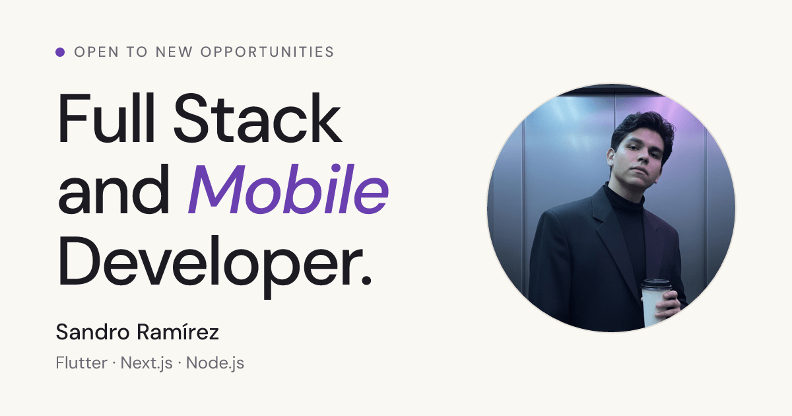

# DevFrame

My personal portfolio: a fast, minimal site that presents my experience, skills and the products I have built as a Full Stack and Mobile Developer.



[**Live site**](https://dev-frame.vercel.app)

---

## Highlights

- **Built for hiring teams.** A clear structure: experience, expertise, selected work and contact.
- **Case study of Antoja**, a three-app Flutter food delivery platform, with real screenshots of each app.
- **Light and dark themes** that follow the system by default, remember the visitor's choice and never flash the wrong theme on load.
- **Motion with restraint.** Scroll reveals and small hover interactions with Framer Motion, all disabled for visitors who prefer reduced motion.
- **Responsive** from small phones to wide desktops.
- **Share-ready.** A cover image for link previews is generated at build time with Open Graph and Twitter metadata.
- **Accessible details:** semantic markup, visible focus states and descriptive alt text.

## Tech stack

Next.js 16 (App Router) · React 19 · TypeScript · Tailwind CSS 4 · Framer Motion · Lucide icons · DM Sans and DM Mono · deployed on Vercel

## Getting started

**Requirements:** Node.js 20 or newer.

```bash
git clone https://github.com/Dashxl/DevFrame.git
cd DevFrame
npm install
npm run dev
```

Open [http://localhost:3000](http://localhost:3000).

| Script | What it does |
| --- | --- |
| `npm run dev` | Starts the development server. |
| `npm run build` | Creates the production build. |
| `npm run start` | Serves the production build. |
| `npm run lint` | Runs ESLint. |

## Configuration

| Variable | Required | Description |
| --- | :---: | --- |
| `NEXT_PUBLIC_SITE_URL` | No | Public URL of the site, used for absolute links in link previews. Defaults to `https://dev-frame.vercel.app`. |

## Project structure

```text
src/
  app/
    layout.tsx             Fonts, metadata and theme initialization
    globals.css            Design tokens (light and dark) and base styles
    opengraph-image.tsx    Link preview image, generated at build time
  components/
    sections/              Navbar, Hero, Experience, Expertise, Work, Footer
    ui/                    Reveal, SectionHeader, ThemeToggle, AppPhones, Gengar
assets/                    Fonts and photo used to render the link preview image
public/                    Images served by the site
docs/                      Preview image used in this README
```

## Design notes

The palette is warm paper, ink and a single deep purple accent, defined as CSS variables in `globals.css` so both themes stay consistent. Headlines use a tight, large type scale and rely on whitespace and thin rules rather than cards or shadows.

## Author

**Sandro Ramírez** · Full Stack and Mobile Developer · [LinkedIn](https://www.linkedin.com/in/dscp-sandro-ramirez/) · [GitHub](https://github.com/Dashxl)
